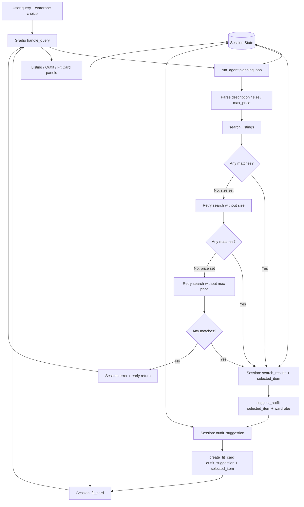

# FitFindr — planning.md

This document is the implementation spec for FitFindr. I completed it before writing the project implementation so the code, tests, README, and demo can be checked against the same design.

---

## A Complete Interaction

FitFindr takes a natural-language thrift request, extracts the item description and optional size/price constraints, then calls `search_listings`. If matches exist, the highest-ranked listing becomes the selected item and is stored in session state. The agent passes that exact item plus the user's wardrobe into `suggest_outfit`, then passes the returned outfit suggestion and selected item into `create_fit_card`.

If the first search returns no results, the agent uses retry logic instead of blindly continuing. It retries once with the size constraint removed, and if necessary retries again with the price ceiling removed. The session records which constraints were relaxed. If all attempts are empty, the agent stops early, stores a helpful error message, and does not call the outfit or fit-card tools.

---

## Tools

### Tool 1: `search_listings`

**What it does:**  
Searches the provided mock secondhand-listings dataset for items relevant to a user's description. It applies optional size and maximum-price filters, scores the remaining listings by keyword overlap across title, description, category, style tags, colors, brand, and platform, and returns the best matches first.

**Input parameters:**
- `description` (`str`): Natural-language keywords describing the desired item, such as `"vintage graphic tee"`.
- `size` (`str | None`): Optional size filter such as `"M"`, `"W30"`, or `"8"`. `None` means no size restriction.
- `max_price` (`float | None`): Optional inclusive maximum price. `None` means no price restriction.

**What it returns:**  
`list[dict]`. Each dictionary is an original listing with these fields: `id`, `title`, `description`, `category`, `style_tags`, `size`, `condition`, `price`, `colors`, `brand`, and `platform`. Results are ordered from highest relevance score to lowest. An empty list means no listing matched the current constraints.

**What happens if it fails or returns nothing:**  
The function catches dataset-loading problems and returns `[]` instead of crashing the app. In the planning loop, an empty first result triggers the stretch retry logic: retry without `size`, then if needed retry without `max_price`. The user is told which filter was relaxed. If all searches remain empty, the agent returns early with a specific error and suggestions to broaden the item description, size, or budget.

---

### Tool 2: `suggest_outfit`

**What it does:**  
Creates one or two complete outfit ideas around the selected thrift listing. When wardrobe items are available, the prompt asks the LLM to use named pieces from that wardrobe; when the wardrobe is empty, it gives general styling advice instead.

**Input parameters:**
- `new_item` (`dict`): The selected listing dictionary produced by `search_listings`.
- `wardrobe` (`dict`): A wardrobe dictionary with an `items` key containing a list of wardrobe-item dictionaries. Each item can contain `id`, `name`, `category`, `colors`, `style_tags`, and `notes`.

**What it returns:**  
`str`. A non-empty outfit suggestion describing 1–2 complete looks, including specific wardrobe pieces when they exist.

**What happens if it fails or returns nothing:**  
If `wardrobe["items"]` is empty, the tool still calls the LLM for useful general styling advice rather than failing. If the selected item is missing or invalid, it returns a clear error string. If the Groq call fails or the API key is unavailable, it returns a readable fallback message instead of raising an exception, so the agent remains usable and the failure is visible to the user.

---

### Tool 3: `create_fit_card`

**What it does:**  
Turns the outfit suggestion into a short, shareable social-style fit caption that mentions the thrifted item's title, price, and platform naturally.

**Input parameters:**
- `outfit` (`str`): The outfit suggestion returned by `suggest_outfit`.
- `new_item` (`dict`): The same selected listing dictionary stored in session state.

**What it returns:**  
`str`. A casual 2–4 sentence fit-card caption suitable for an Instagram/TikTok-style post. The Groq request uses a higher temperature so different item/outfit inputs produce varied wording.

**What happens if it fails or returns nothing:**  
If `outfit` is empty or whitespace-only, the function immediately returns `"I couldn't create a fit card because the outfit suggestion was empty."` instead of calling the LLM. If the item is missing or the LLM call fails, the function returns an informative fallback/error string rather than throwing an exception.

---

### Additional behavior: retry logic with fallback (stretch)

This is implemented in the planning loop rather than as a fourth tool. If the first `search_listings(description, size, max_price)` call returns no matches, the agent retries with the size removed. If that still returns nothing and a price ceiling was provided, it retries once more with the price ceiling removed. Every relaxed constraint is written to `session["adjustments"]` so the UI can tell the user what changed.

---

## Planning Loop

The planning loop is implemented in `run_agent(query, wardrobe)` and uses conditional branches rather than always calling all tools.

1. Create a new session dictionary with the original query, wardrobe, empty result fields, `adjustments`, and `error=None`.
2. Parse the query with deterministic regex/string logic:
   - detect a maximum price from phrases such as `under $30`, `below 40`, or `$30 max`;
   - detect a size from phrases such as `size M`, `in size M`, `size 8`, or common clothing-size tokens;
   - remove those constraint phrases plus filler request words from the text to produce the search `description`.
3. Store `description`, `size`, and `max_price` in `session["parsed"]`.
4. Call `search_listings(description, size, max_price)` and store the list in `session["search_results"]`.
5. If the list is empty and `size` is not `None`, call `search_listings(description, None, max_price)`. If this succeeds, store the new results and append a message to `session["adjustments"]` explaining that size was relaxed.
6. If the list is still empty and `max_price` is not `None`, call `search_listings(description, None, None)`. If this succeeds, store the new results and append a message explaining that the price ceiling was relaxed.
7. If the list is still empty, set `session["error"]` to a helpful message and return immediately. At this point `selected_item`, `outfit_suggestion`, and `fit_card` remain `None`; the later tools are not called.
8. If results exist, set `session["selected_item"] = session["search_results"][0]`.
9. Call `suggest_outfit(session["selected_item"], session["wardrobe"])` and store the returned string in `session["outfit_suggestion"]`.
10. If the outfit tool unexpectedly returns an empty string, set `session["error"]` and return before creating a fit card.
11. Call `create_fit_card(session["outfit_suggestion"], session["selected_item"])` and store it in `session["fit_card"]`.
12. Return the completed session. The app reads the same session and maps it into the three Gradio output panels.

The loop is complete when either an unrecoverable search/outfit error causes an early return or a non-empty `fit_card` has been stored.

---

## State Management

One dictionary represents the state of a single user interaction. It is created once in `_new_session` and then updated after each step so later tools do not ask the user to repeat information.

The session contains:
- `query`: original natural-language request.
- `parsed`: `description`, `size`, and `max_price` extracted from the query.
- `search_results`: the most recent successful list of listing dictionaries.
- `selected_item`: the exact top listing dictionary passed to `suggest_outfit` and later to `create_fit_card`.
- `wardrobe`: the selected example or empty wardrobe dictionary.
- `outfit_suggestion`: exact string returned by `suggest_outfit` and passed into `create_fit_card`.
- `fit_card`: final caption string.
- `adjustments`: list of fallback changes made by the retry logic.
- `error`: `None` during a successful run or a user-facing explanation when the agent stops early.

The important state-flow requirement is that the agent does not reconstruct or re-enter values between tools: `selected_item` comes directly from `search_results[0]`, and `outfit_suggestion` comes directly from the second tool's return value.

---

## Error Handling

| Tool / stage | Failure mode | Agent response |
|---|---|---|
| `search_listings` | No results match the original query | Retry without size, then retry without max price if needed. Record each relaxation. If still empty: `"I couldn't find a matching listing even after loosening the size and price filters. Try a broader item description, another size, or a higher budget."` |
| `search_listings` | Dataset cannot be loaded | Return `[]`; the planning loop treats it as no usable results and returns a user-facing search error instead of crashing. |
| `suggest_outfit` | Wardrobe is empty | Ask the LLM for general styling ideas that do not assume the user owns specific pieces. |
| `suggest_outfit` | Missing/invalid selected item or Groq failure | Return a specific readable message indicating that styling could not be generated. The caller never receives an exception. |
| `create_fit_card` | Outfit input is empty or whitespace | Return `"I couldn't create a fit card because the outfit suggestion was empty."` without calling the LLM. |
| `create_fit_card` | Missing item details or Groq failure | Return an informative fallback/error string rather than raising an exception. |
| `handle_query` | User submits blank text | Return `"Please describe what you're looking for."` in the listing panel and leave the other panels blank. |

---

## Architecture



---

## AI Tool Plan

### Milestone 1 — Explore the starter repo

I will use **ChatGPT** to help check my understanding after I inspect the starter files myself. I will provide 5–10 sample records from `data/listings.json`, the structure from `data/wardrobe_schema.json`, and the public interfaces in `utils/data_loader.py`. I expect a short description of the listing fields, the difference between `get_example_wardrobe()` and `get_empty_wardrobe()`, and a trace of the example request through the three required tools. I will verify the response directly against the source files before adding the final 2–3 sentence interaction description to this document.

### Milestone 2 — Write the implementation spec

I will use **ChatGPT** as a spec reviewer. I will provide the Tools, Planning Loop, State Management, Error Handling, and Architecture sections from this file and ask it to identify vague inputs, outputs, branches, or state transitions. I expect implementation-ready wording rather than code. I will verify that every required function has exact parameter names/types and return behavior, the diagram is text-based Mermaid, the error path stops before later tools, and the walkthrough names exact tool inputs and state updates.

### Milestone 3 — Individual tool implementations

I will use **ChatGPT**. For `search_listings`, I will provide the Tool 1 section of this document plus the actual `load_listings()` helper and ask for an implementation that preserves the exact starter signature, applies size/price filters, calculates text relevance, returns the original listing dictionaries, and returns `[]` for no matches. I will verify it with a normal graphic-tee query, an impossible query, and a strict price query.

For `suggest_outfit`, I will provide the Tool 2 section, the wardrobe schema, and the required Groq model name. I will verify that the generated code uses the exact `new_item, wardrobe` signature, uses named wardrobe pieces when available, handles an empty `items` list, and catches LLM errors rather than crashing.

For `create_fit_card`, I will provide the Tool 3 section and the fit-card style requirements. I will verify that it checks empty outfit input before the LLM call, mentions item title/price/platform in the prompt, uses higher temperature, and returns a string for both success and failure paths.

I will add `tests/test_tools.py` with deterministic pytest coverage. LLM calls will be monkeypatched in unit tests so tests verify prompt/control behavior without depending on network availability or spending API quota.

### Milestone 4 — Planning loop and state management

I will give **ChatGPT** the Planning Loop, State Management, Error Handling, and Architecture sections of this file along with the starter `agent.py`. The implementation must use the existing session dictionary, add `adjustments`, parse query constraints, branch when search results are empty, and pass the exact stored values into later tools. I will review the code to make sure all three tools are not called unconditionally.

For `app.py`, I will provide the session field definitions and the starter TODO. I will verify that blank input is handled, the correct wardrobe helper is selected, agent errors appear in the first output panel, and a successful selected item is formatted with title, price, platform, size, condition, and any retry adjustments.

Before accepting generated code, I will compare each function signature against this spec and run `python -m pytest tests/` plus the `agent.py` happy-path/no-results examples.

### Milestone 5 — Deliberately test failures

I will use **ChatGPT** to review the failure test matrix, not to assume the failures work. I will provide the Error Handling table and the three required terminal scenarios: impossible search, empty wardrobe, and empty outfit. I expect concrete assertions for each case and suggestions for any missing branch coverage. I will verify the behavior by intentionally triggering each case and confirming that no unhandled exception occurs, the message is actionable, and later tools are skipped when search has no usable result.

### Milestone 6 — Documentation and demo

I will use **ChatGPT** as a rubric checker for `README.md` and as a demo-outline assistant. I will provide the final README, this planning document, and the assignment checklist. I expect it to flag any mismatch between documented signatures and actual code and produce a 3–5 minute narration outline covering the happy path, state passing, and one failure path. I will verify the README against the actual function signatures and run the app end-to-end before recording. The video URL itself will be added manually to the README after recording.

---

## Complete Interaction Walkthrough

**Example user query:** `"I'm looking for a vintage graphic tee under $30. I mostly wear baggy jeans and chunky sneakers. What's out there and how would I style it?"`

**Step 1 — parse and search:**  
The agent extracts approximately `description="vintage graphic tee"`, `size=None`, and `max_price=30.0`, stores those values in `session["parsed"]`, then calls:

```python
search_listings("vintage graphic tee", size=None, max_price=30.0)
```

The search returns relevant listing dictionaries such as the bootleg-style graphic tee and/or vintage band tee, ranked by keyword overlap. The full list is stored in `session["search_results"]`, and the first dictionary is stored as `session["selected_item"]`.

**Step 2 — outfit suggestion:**  
The planning loop calls:

```python
suggest_outfit(session["selected_item"], session["wardrobe"])
```

With the example wardrobe, the prompt can use pieces such as `Baggy straight-leg jeans, dark wash`, `Chunky white sneakers`, `Black combat boots`, or the `Vintage black denim jacket`. The returned string is stored unchanged in `session["outfit_suggestion"]`.

**Step 3 — fit card:**  
The agent calls:

```python
create_fit_card(session["outfit_suggestion"], session["selected_item"])
```

The resulting caption is stored in `session["fit_card"]`.

**Final output to user:**  
The interface shows the selected listing and its details in the first panel, the complete styling recommendation in the second panel, and a short social-ready caption in the third panel. If any constraints were relaxed, the listing panel also tells the user what FitFindr changed.

**Failure-path example:** `"designer ballgown size XXS under $5"` first searches with all constraints, then retries without size, then without the price ceiling. If the dataset still contains no relevant ballgown, the session gets an error message and the outfit/fit-card tools are never called.
